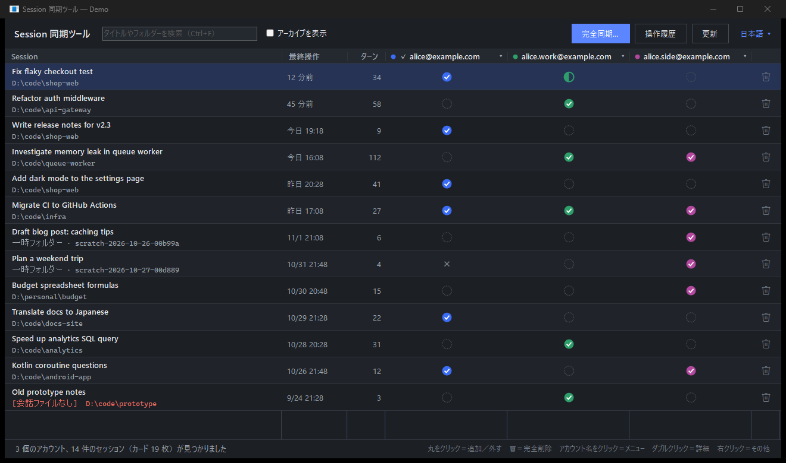
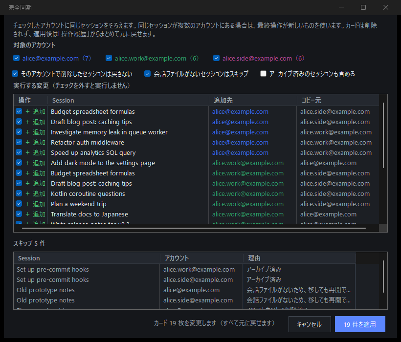
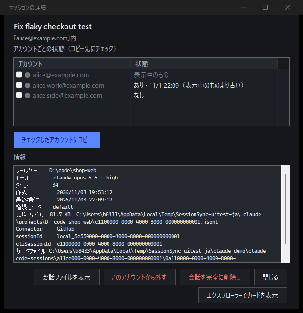
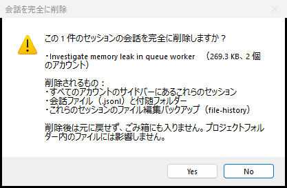

# Session 同期ツール（Claude デスクトップ用）

[English](README.md) · [繁體中文](README.zh-TW.md) · **日本語**

このパソコンにあるすべてのアカウントの Claude デスクトップ（Code タブ）のセッションを 1 つの画面にまとめて表示し、コピー・同期・非表示・削除ができます。



*スクリーンショットは架空のデモデータ（`SessionSync.exe --demo`）です。*

## なぜ必要か

Claude デスクトップのサイドバーの一覧は、アカウントごとに別々に保存されています。アカウントを切り替えるとセッションが消えたように見えますが、会話ファイルはディスクに残っています。会話ファイルは全アカウントで共有されていて、一覧だけが分かれているからです。このツールは各アカウントの一覧を並べて表示し、アカウント間でセッションを移せるようにします。

## 機能

- **ひとつの表**：セッション 1 件につき 1 行、アカウントごとに 1 列で表示します。
  - ✔：このアカウントにある
  - ◐：あるが古い
  - ◌：ない
  - ✕：このアカウントで削除済み
- **丸をクリック**すると、そのアカウントにセッションを追加したり、そのアカウントから外したりできます。
- **完全同期**：複数のアカウントに同じセッションをそろえます。先にプレビューが表示され、最新のものが使われます。
- **完全削除**（🗑 または Shift+Del）：全アカウントからセッションを外し、会話ファイル、付随フォルダー、file-history のバックアップを削除します。実行前に確認があります。
- **アカウントメニュー**（アカウント名をクリック）：
  - 名前の変更
  - 非表示
  - 一覧のセッションを追加
  - このアカウントのセッションをすべて削除（ほかのアカウントにもあるセッションは、このアカウントから外すだけです）
- **操作履歴と元に戻す**：変更の前に必ずバックアップを取ります。操作のあとでファイルが変更されていた場合は、元に戻す前に確認します。
- **わかりやすい名前**：Claude のローカルキャッシュからアカウントのメールアドレスを読み取ります。セッションのないアカウントは自動で非表示になります。
- **繁體中文／English／日本語**、ライト・ダークモードに対応しています。約 170 KB の exe ひとつで動き、インストールは不要です。

| 完全同期 | 詳細 | 削除の確認 |
|---|---|---|
|  |  |  |

## 使い方

1. Releases から `SessionSync.exe` をダウンロードするか、自分でビルドします（下記参照）。
2. ダブルクリックで起動します。Claude のフォルダーは自動で見つけます。
3. まず試したい場合は `SessionSync.exe --demo` を実行してください。一時フォルダーに架空のアカウントを作って表示し、実際のデータは読みません。

動作環境は Windows 10 / 11 です。使用する .NET Framework 4.8 は Windows に標準で入っています。

exe にはコード署名がないため、初回起動時に Windows SmartScreen の「Windows によって PC が保護されました」が表示されることがあります。その場合は**詳細情報 → 実行**を押すか、ソースから自分でビルドしてください。

ログイン中のアカウントの一覧を変更した場合、サイドバーに反映させるには Claude を再起動してください。ログイン中のアカウントのカードを外したり上書きしたりする前には Claude を閉じてください。閉じずに操作すると、Claude がカードを書き戻すことがあります。

## 変更するファイル

```
%LOCALAPPDATA%\Claude-Data\claude_*\claude-code-sessions\<アカウント>\<組織>\local_<id>.json   サイドバーのカード（アカウントごと）
%LOCALAPPDATA%\Claude-Data\claude_*\claude-code-sessions\<アカウント>\<組織>\deleted_<id>       削除の記録
%USERPROFILE%\.claude\projects\<プロジェクト>\<cliSessionId>.jsonl                               会話ファイル（共有）
```

- コピーは、カードファイルを別のアカウントのフォルダーへ**バイト単位でそのまま**複製します。内容を書き換えることはありません。
- アカウントから外すと、そのアカウントのカードを削除し、Claude 自身が書くのと同じ削除記録を残します。
- 会話ファイルを削除するのは**完全削除**だけです。会話ファイル、付随フォルダー、`~/.claude/file-history/<id>` を削除します。ID が通常の UUID でない場合は削除しません。
- バックアップ、履歴、名前、設定は `%LOCALAPPDATA%\claude-session-sync\` に保存します。
- すべてローカルで動作し、ネットワーク通信は一切行いません。

## ビルド

SDK は不要で、Windows に付属の C# コンパイラーでビルドできます。

```
build.cmd          SessionSync.exe を作成
build.cmd test     データ層のテスト（一時フォルダーのみ使用）
build.cmd uitest   デモデータで UI 全体をテストし、docs\screenshots にスクリーンショットを保存
```

UI テストは実際のウィンドウを開き、デモデータで 1 分ほど動かしてから閉じます。

## 制限

- Windows 専用です。
- 現在の Claude デスクトップのファイル構成に依存しています。Claude のアップデートで構成が変わる可能性があるため、アップデート後はセッションが正しく表示されるか確認してください。
- ログイン中のアカウントへの変更は、Claude の再起動後に反映されます。
- Remote Control やクラウドのセッションには触れません。

## 免責事項

非公式のツールです。Anthropic とは関係がなく、Anthropic が承認したものでもありません。「Claude」は Anthropic の商標です。ご利用は自己責任でお願いします。**完全削除は元に戻せません。**

## ライセンス

[MIT](LICENSE)
