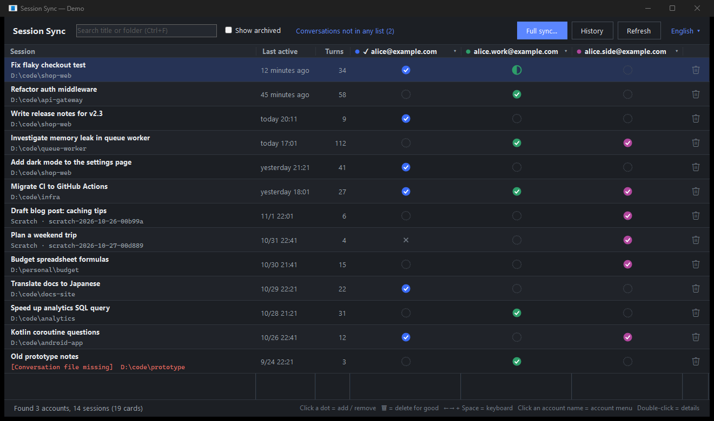
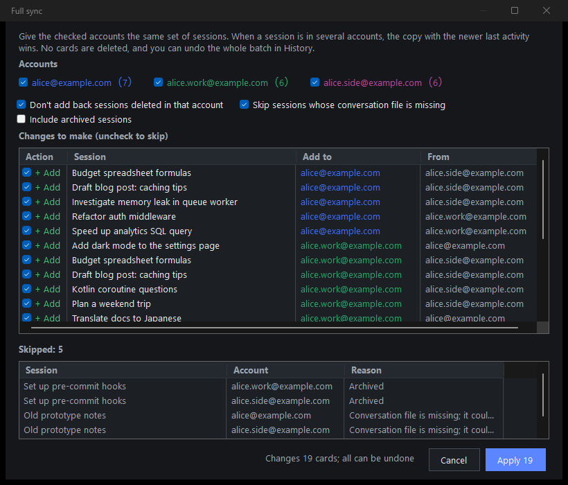
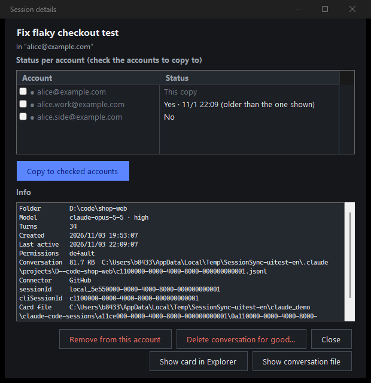
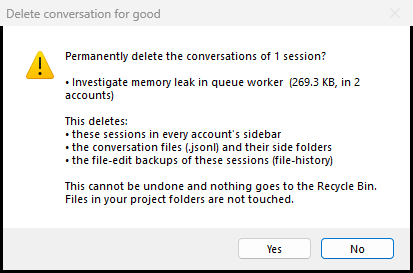

# Session Sync

> Unofficial. Not affiliated with or endorsed by Anthropic.

**English** · [繁體中文](README.zh-TW.md) · [日本語](README.ja.md)

See every Claude desktop (Code tab) session from all the accounts on your PC in one window — and copy, sync, hide or delete them.



*Screenshots use made-up demo data (`SessionSync.exe --demo`).*

## Why

Claude desktop keeps a separate sidebar list for each account. Switch accounts and your sessions seem to vanish, even though the conversations are still on disk: they're shared by all accounts, only the list is per account. Session Sync shows all lists side by side and lets you move sessions between them.

## Features

- **One grid**: every session once, one column per account.
  - ✔ = this account has it
  - ◐ = this account has an older copy
  - ◌ = this account doesn't have it
  - ✕ = deleted in this account
- **Click a dot** to add a session to that account, or to remove it from that account.
- **Full sync**: give several accounts the same set of sessions. You get a preview first, and the newest copy wins.
- **Delete for good** (🗑 or Shift+Del): removes the session from every account plus its transcript, side folder and file-history backups. You confirm first.
- **Account menu** (click an account name): rename it, hide it, add the listed sessions to it, or delete everything in it. Sessions other accounts also have are only removed from this account.
- **History and undo**: every change is backed up first. Undo warns you if a file changed afterwards.
- **Readable names**: account e-mails are learned from Claude's local cache. Accounts with no sessions are hidden automatically.
- **繁體中文 / English / 日本語**, light and dark mode, tiny and fast: one ~170 KB exe that needs no install.

| Full sync | Details | Delete confirmation |
|---|---|---|
|  |  |  |

## Get started

1. Download `SessionSync.exe` from Releases, or build it (see below).
2. Double-click it. It finds Claude's folders by itself.
3. Want to look around first? Run `SessionSync.exe --demo`. That opens made-up accounts in a temp folder and doesn't read your real data.

Requirements: Windows 10 or 11. The .NET Framework 4.8 it uses is built into Windows.

The exe is not code-signed, so Windows SmartScreen may warn the first time you run it ("Windows protected your PC"). Click **More info → Run anyway**, or build it yourself from the source.

After changing the list of the **signed-in** account, restart Claude to see the change in its sidebar. Before removing or overwriting cards of the signed-in account, close Claude, or it may write them back.

## What it touches

```
%LOCALAPPDATA%\Claude-Data\claude_*\claude-code-sessions\<account>\<org>\local_<id>.json   sidebar card (per account)
%LOCALAPPDATA%\Claude-Data\claude_*\claude-code-sessions\<account>\<org>\deleted_<id>       delete record
%USERPROFILE%\.claude\projects\<project>\<cliSessionId>.jsonl                               conversation (shared)
```

- Copying a session copies its card file **byte for byte** into another account's folder. Cards are never rewritten.
- Removing a session from an account deletes that account's card and writes the same delete record Claude writes itself.
- Only **Delete for good** deletes conversation files. It removes the transcript, its side folder and `~/.claude/file-history/<id>`, and it refuses ids that aren't plain UUIDs.
- Backups, history, names and settings live in `%LOCALAPPDATA%\claude-session-sync\`.
- Everything is local. The app makes no network requests.

## Build from source

No SDK needed. The C# compiler that ships with Windows is enough.

```
build.cmd          builds SessionSync.exe
build.cmd test     data-layer tests (temp folders only)
build.cmd uitest   end-to-end UI test on demo data; writes docs\screenshots
```

The UI test opens real windows on demo data for a minute and closes them again.

## Limitations

- Windows only.
- Session Sync relies on how Claude desktop lays out its files today. A Claude update can change that, so check that your sessions still look right after updating Claude.
- Changes to the signed-in account show up in Claude after a restart.
- Remote Control and cloud sessions are not touched.

## Disclaimer

This is an unofficial tool and is not affiliated with or endorsed by Anthropic. "Claude" is a trademark of Anthropic. Use it at your own risk, and keep in mind that **Delete for good** cannot be undone.

## License

[MIT](LICENSE)
