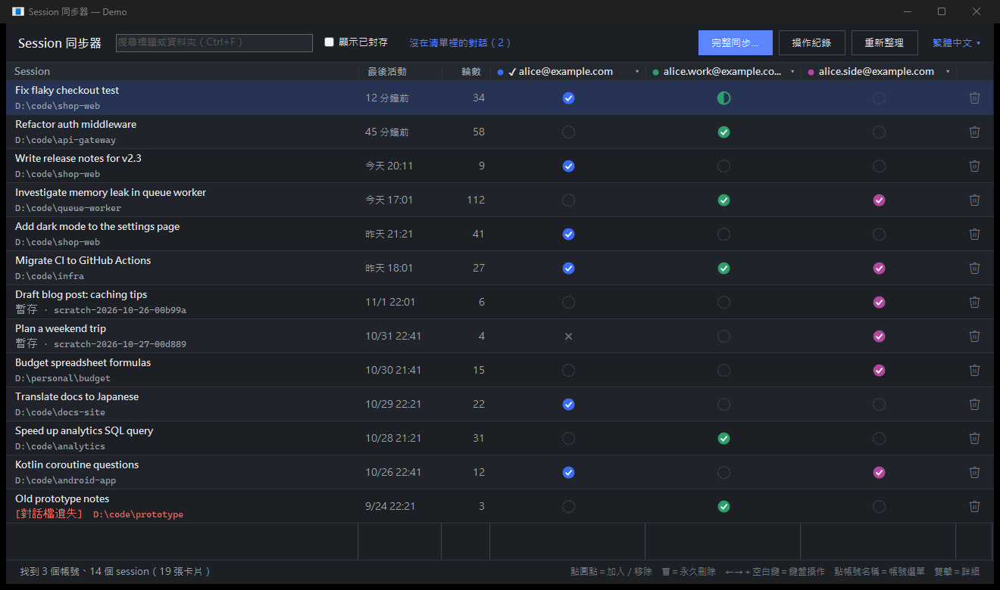
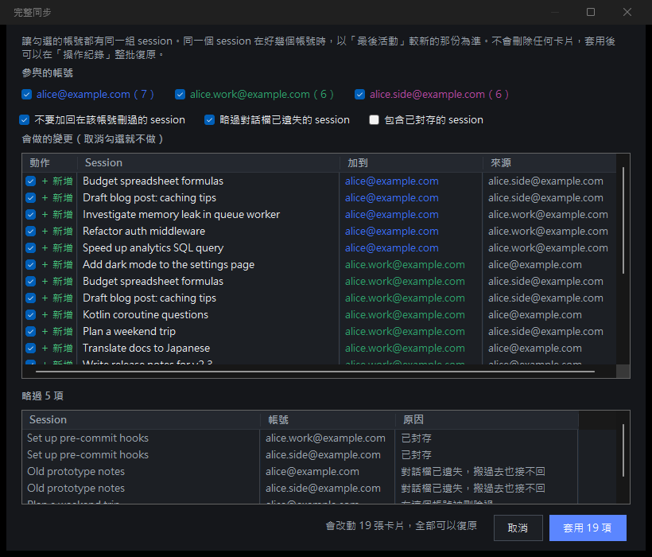
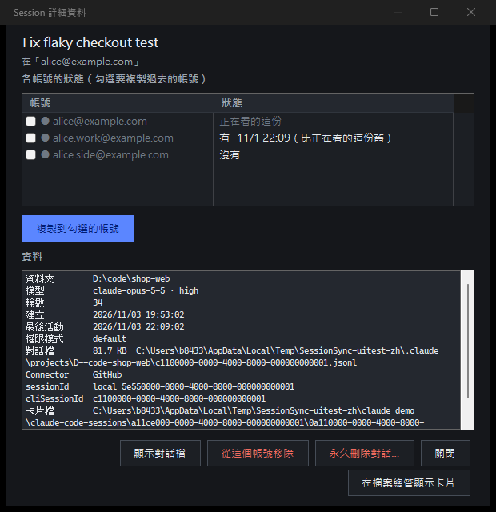
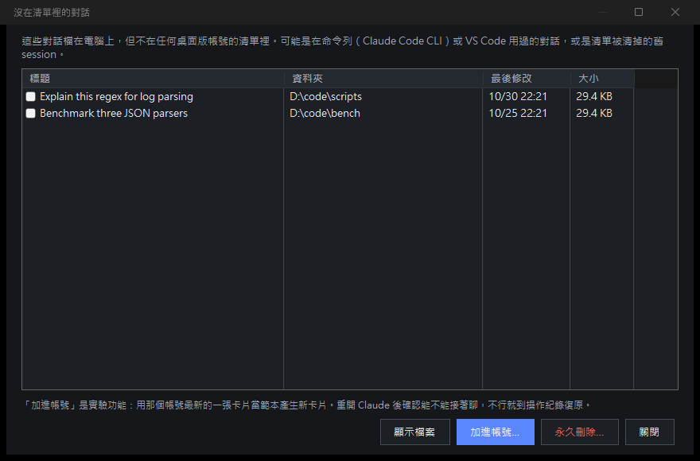
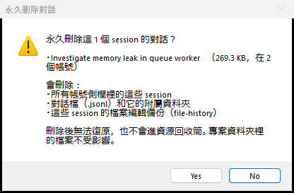

# Session 同步器

> 非官方工具，與 Anthropic 無關，也未經其認可。

[English](README.md) · **繁體中文** · [日本語](README.ja.md)

[](https://github.com/b84330808/session-sync/actions/workflows/build.yml)

在一個視窗裡看到這台電腦上所有帳號的 Claude 桌面版（Code 分頁）session，可以複製、同步、隱藏或刪除。



*截圖用的是虛構的示範資料（`SessionSync.exe --demo`）。*

## 為什麼需要它

Claude 桌面版的側欄清單是每個帳號各自一份。換帳號之後 session 好像不見了，其實對話檔還在電腦上：對話檔所有帳號共用，只有清單分開。這個程式把各帳號的清單排在一起，讓你在帳號之間搬 session。

## 功能

- **一張總表**：每個 session 一列，每個帳號一欄。
  - ✔ = 這個帳號有
  - ◐ = 有，但比較舊
  - ◌ = 沒有
  - ✕ = 在這個帳號刪過
- **點圓點**：把 session 加進那個帳號，或從那個帳號移除。
- **完整同步**：讓幾個帳號都有同一組 session。會先預覽，以最新的那份為準。
- **永久刪除**（🗑 或 Shift+Del）：從所有帳號移除這個 session，並刪掉對話檔、附屬資料夾和 file-history 備份。刪之前會先問你。
- **帳號選單**（點帳號名稱）：
  - 改名
  - 隱藏
  - 把列表中的 session 加進來
  - 刪除這個帳號的所有 session：其他帳號也有的，只會從這個帳號移除。
- **沒在清單裡的對話**：找出沒有任何帳號清單顯示的對話檔（常是命令列或 VS Code 用過的）。可以刪掉，或加進某個帳號（實驗功能）。
- **「重開 Claude」按鈕**：Claude 桌面版執行中時出現，讓目前登入帳號的改動馬上生效。
- **鍵盤操作**：↑↓ 選 session、←→ 選帳號欄、空白鍵等於點一下、Shift+Del 永久刪除。
- **Claude 改版時的保護**：如果 Claude 的檔案格式和預期不同，會自動切成唯讀，不會亂改。
- **操作紀錄、復原與重做**：每次改動前都會先備份。如果檔案在操作之後又被改過，復原前會先提醒；剛復原完，狀態列會出現「重做」。
- **好認的名稱**：從 Claude 的本機快取讀出帳號 email。沒有 session 的帳號會自動隱藏。
- **繁體中文／English／日本語**、淺色和深色模式、輕巧快速：單一 exe 約 200 KB，免安裝。

| 完整同步 | 詳細資料 | 沒在清單裡的對話 | 刪除確認 |
|---|---|---|---|
|  |  |  |  |

## 開始使用

1. 從 Releases 下載 `SessionSync.exe`，或自己編譯（見下方）。
2. 雙擊開啟，它會自己找到 Claude 的資料夾。
3. 想先看看？執行 `SessionSync.exe --demo`，會在暫存資料夾開一組虛構的帳號，不會讀你的真實資料。

需要 Windows 10 或 11。程式用到的 .NET Framework 4.8 是 Windows 內建的。

命令列參數：`--demo`、`--lang zh|en|ja`、`--trust-format`（Claude 的檔案格式看起來陌生時仍允許修改，風險自負）。

exe 沒有程式碼簽章，第一次執行時 Windows SmartScreen 可能會跳出「Windows 已保護您的電腦」。按**其他資訊 → 仍要執行**即可，或者自己從原始碼編譯。

改動「目前登入」帳號的清單之後，要重開 Claude 才會在側欄看到。要移除或覆蓋目前登入帳號的卡片時，請先關閉 Claude，不然它可能把卡片寫回去。

## 它會動到什麼

```
%LOCALAPPDATA%\Claude-Data\claude_*\claude-code-sessions\<帳號>\<組織>\local_<id>.json   側欄卡片（每個帳號一份）
%LOCALAPPDATA%\Claude-Data\claude_*\claude-code-sessions\<帳號>\<組織>\deleted_<id>       刪除紀錄
%USERPROFILE%\.claude\projects\<專案>\<cliSessionId>.jsonl                               對話檔（共用）
```

- **複製**：把卡片檔逐位元組複製到另一個帳號的資料夾，不會重寫內容。
- **從帳號移除**：刪掉那個帳號的卡片，並寫入和 Claude 自己一樣的刪除紀錄。
- **永久刪除**：只有這個功能會刪對話檔。它會刪掉對話檔、附屬資料夾和 `~/.claude/file-history/<id>`，不是標準 UUID 的編號一律拒絕。
- 備份、操作紀錄、名稱和設定存在 `%LOCALAPPDATA%\claude-session-sync\`。
- 全部在本機進行，不連網路。

## 自己編譯

不需要 SDK，用 Windows 內建的 C# 編譯器就可以：

```
build.cmd          產生 SessionSync.exe
build.cmd test     資料層測試（只用暫存資料夾）
build.cmd uitest   用示範資料跑完整介面測試，截圖存到 docs\screenshots
```

介面測試會開出真的視窗、用示範資料跑大約一分鐘，然後自己關掉。每次推上 GitHub，GitHub Actions 都會自動編譯並跑這兩種測試。

## 限制

- 只支援 Windows。
- 依賴 Claude 桌面版目前的檔案結構。Claude 更新後可能會改變；發現格式不對時程式會自動切成唯讀，但更新 Claude 之後仍請確認 session 顯示正常。
- 目前登入帳號的改動，要重開 Claude 才看得到。
- 不會動到 Remote Control 和雲端 session。

## 聲明

這是非官方工具，和 Anthropic 沒有關係，也不代表 Anthropic 認可。「Claude」是 Anthropic 的商標。使用風險自負；**永久刪除無法復原**。

## 授權

[MIT](LICENSE)
